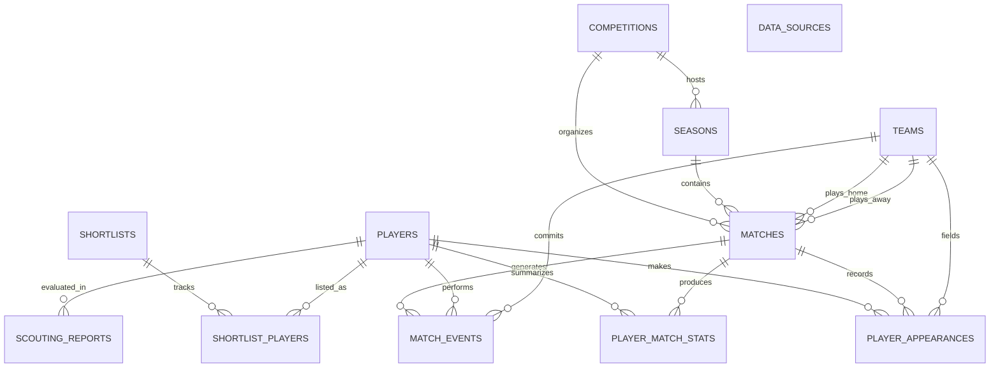

# 12th Man — Database Schema Documentation

## 1. Overview
The database layer is built on **PostgreSQL 18** using **SQLAlchemy 2.x** with strictly typed mappings (`Mapped`, `mapped_column`) and managed via **Alembic** migrations.

All primary keys use UUIDs (`uuid.uuid4`) for provider-independent record identification.

---

## 2. Entity-Relationship Diagram

---

## 3. Table Definitions

### A. Football Models
- **`data_sources`**: Records provenance, provider metadata, and ingestion execution logs.
  - `id`: UUID (PK)
  - `provider_name`: String(50), indexed
  - `dataset_identifier`: String(100)
  - `import_timestamp`: DateTime(timezone=True)
  - `status`: String(30)
  - `source_provenance`: JSONB
  - `records_ingested`: JSONB

- **`competitions`**: Independent competition records.
  - `id`: UUID (PK)
  - `external_id`: String(100), unique, indexed
  - `name`: String(150), indexed
  - `country`: String(100)
  - `gender`: String(20)

- **`seasons`**: Seasons linked to competitions.
  - `id`: UUID (PK)
  - `external_id`: String(100), indexed
  - `competition_id`: UUID, FK -> `competitions.id` (CASCADE)
  - `name`: String(50)
  - `start_year`: Integer, `end_year`: Integer
  - Unique Constraint: `(competition_id, name)`

- **`teams`**: Club or national teams.
  - `id`: UUID (PK)
  - `external_id`: String(100), unique, indexed
  - `name`: String(150), indexed
  - `country`: String(100)
  - `gender`: String(20)

- **`players`**: Provider-independent player master entities.
  - `id`: UUID (PK)
  - `external_id`: String(100), unique, indexed
  - `name`: String(150), indexed
  - `birth_date`: Date
  - `nationality`: String(100), indexed
  - `preferred_foot`: String(20)
  - `height`: Integer (cm)
  - `primary_position`: String(50), indexed

- **`matches`**: Fixture and match outcome records.
  - `id`: UUID (PK)
  - `external_id`: String(100), unique, indexed
  - `competition_id`: UUID, FK -> `competitions.id` (CASCADE)
  - `season_id`: UUID, FK -> `seasons.id` (CASCADE)
  - `home_team_id`: UUID, FK -> `teams.id` (RESTRICT)
  - `away_team_id`: UUID, FK -> `teams.id` (RESTRICT)
  - `match_date`: Date, indexed
  - `match_datetime`: DateTime(timezone=True)
  - `home_score`: Integer, `away_score`: Integer
  - `match_metadata`: JSONB

- **`player_appearances`**: Match-level player appearance records.
  - `id`: UUID (PK)
  - `player_id`: UUID, FK -> `players.id` (CASCADE)
  - `match_id`: UUID, FK -> `matches.id` (CASCADE)
  - `team_id`: UUID, FK -> `teams.id` (RESTRICT)
  - `is_starter`: Boolean
  - `is_substitute`: Boolean
  - `minutes_played`: Integer
  - `shirt_number`: Integer
  - `position`: String(50)
  - Unique Constraint: `(player_id, match_id, team_id)`

- **`match_events`**: Granular telemetry event records with full JSONB payload.
  - `id`: UUID (PK)
  - `external_id`: String(100), unique, indexed
  - `match_id`: UUID, FK -> `matches.id` (CASCADE)
  - `player_id`: UUID, FK -> `players.id` (SET NULL)
  - `team_id`: UUID, FK -> `teams.id` (SET NULL)
  - `event_type`: String(100), indexed
  - `period`: Integer, `minute`: Integer, `second`: Integer
  - `location_x`: Float, `location_y`: Float
  - `attributes`: JSONB (structured extraction)
  - `raw_payload`: JSONB (complete StatsBomb event payload)
  - Composite Indexes: `(match_id, event_type)`, `(player_id, event_type)`

- **`player_match_stats`**: Derived statistical performance records per match.
  - `id`: UUID (PK)
  - `player_id`: UUID, FK -> `players.id` (CASCADE)
  - `match_id`: UUID, FK -> `matches.id` (CASCADE)
  - `team_id`: UUID, FK -> `teams.id` (RESTRICT)
  - Metrics: `minutes_played`, `goals`, `assists`, `shots`, `shots_on_target`, `passes_attempted`, `passes_completed`, `key_passes`, `tackles`, `interceptions`, `clearances`, `fouls_committed`, `fouls_won`, `yellow_cards`, `red_cards`, `aerials_won`, `dribbles_completed`, `duels_won`, `touches`, `xg`, `xa`
  - `detailed_stats`: JSONB
  - Unique Constraint: `(player_id, match_id)`

### B. Scouting & Recruitment Models
- **`scouting_reports`**: Qualitative scouting assessments.
  - `id`: UUID (PK)
  - `player_id`: UUID, FK -> `players.id` (CASCADE)
  - `scout_name`: String(100)
  - `position_assessed`: String(50)
  - `technical_rating`, `tactical_rating`, `physical_rating`, `mental_rating`, `overall_rating`: Float
  - `strengths`, `weaknesses`: JSONB
  - `written_observations`: Text
  - `assessment_date`: Date

- **`shortlists`**: Recruitment shortlists.
  - `id`: UUID (PK)
  - `name`: String(150), `description`: Text, `owner`: String(100)

- **`shortlist_players`**: Shortlist candidate associations.
  - `id`: UUID (PK)
  - `shortlist_id`: UUID, FK -> `shortlists.id` (CASCADE)
  - `player_id`: UUID, FK -> `players.id` (CASCADE)
  - `recruitment_status`: String(50) (e.g. "Target", "In Review", "Signed")
  - `notes`: Text
  - Unique Constraint: `(shortlist_id, player_id)`
